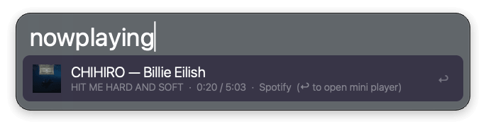
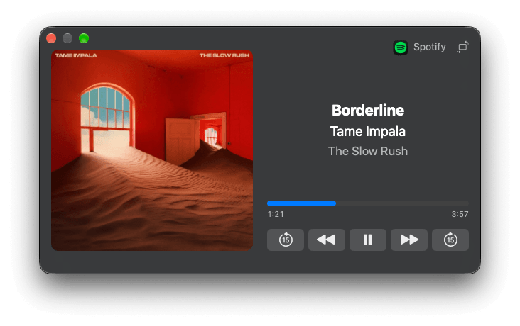
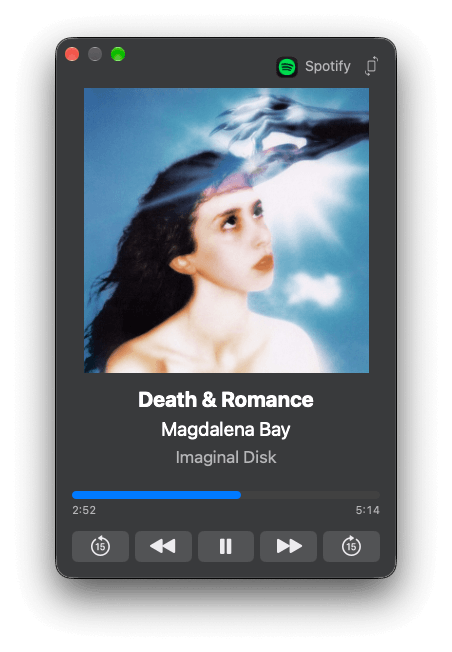

# Now Playing

## Usage

See the status of currently playing **music** or **video** via the `nowplaying` (or `np`) keyword, and launch a mini player panel.

Works with *any* music or video playing on your Mac — not limited to a particular music player.

- <kbd>↩</kbd> Open the mini player panel

## The Mini Player

The mini player is an interactive, resizeable window showing the currently playing item, with simple playback controls. Configure the Hotkey to open it directly.

- Click the App icon/title to bring the currently playing app to the foreground
- Use the "Rotate" button in the top-right corner to toggle between **Landscape** and **Portrait** mode, and drag the corners to re-size the window

- <kbd>Esc</kbd> Close the panel
- <kbd>Space</kbd> Start/stop playback

## Configuration

Set the workflow's keyword triggers, and adjust various parameters of the mini player:

- **Window buttons**: turn off the player window's close/maximise buttons for a simpler, sleek look
- **Corner radius**: rounding of the player's corners when the window buttons are off
- **Transparency**: solid or see-through — you decide
- **Default app**: when nothing is playing the mini player window presents a link to open this app

## Acknowledgements

Includes [mediaremote-adapter](https://github.com/ungive/mediaremote-adapter) by Jonas van den Berg (BSD 3-Clause licence), which provides the now-playing information.

Workflow created with the assistance of [Claude Code](https://claude.com/product/claude-code).

<!-- end of Alfred readme -->

---

Download the latest version from the [Alfred forum](https://www.alfredforum.com/topic/24235-now-playing-%C2%A0see-currently-playing-track-and-launch-a-mini-player/). For how the workflow is built, see the [developer notes](DEVELOPMENT.md).
