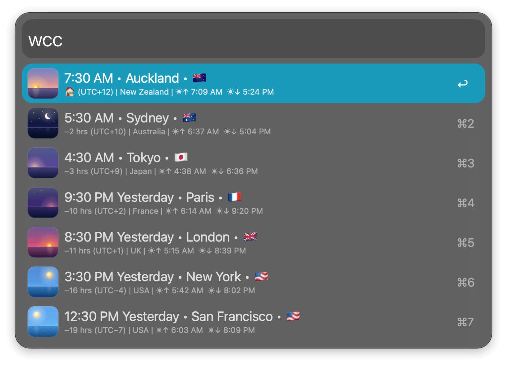
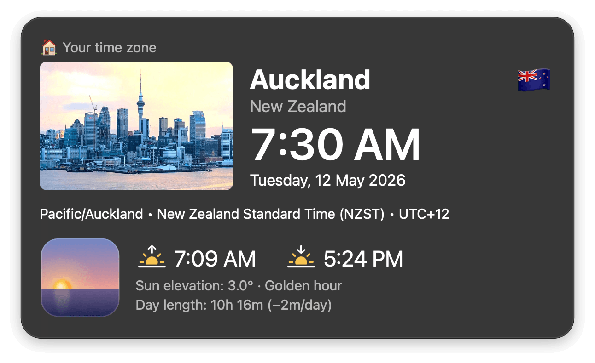
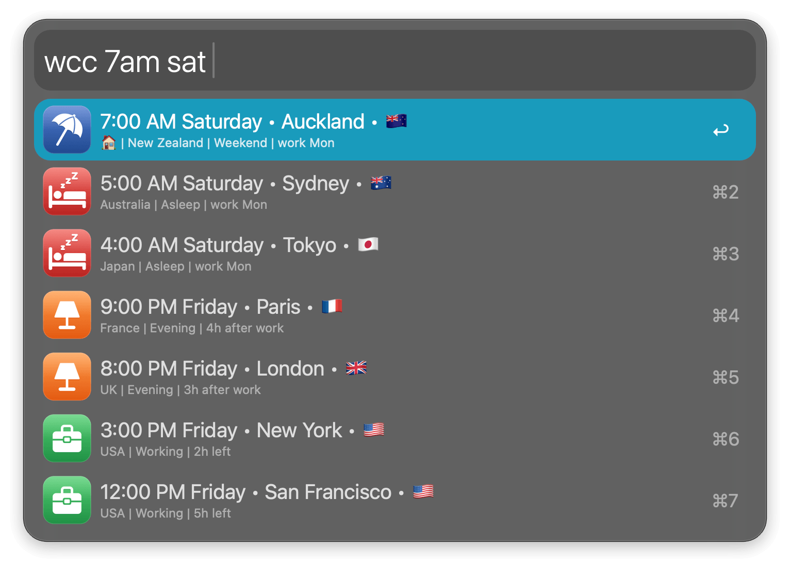
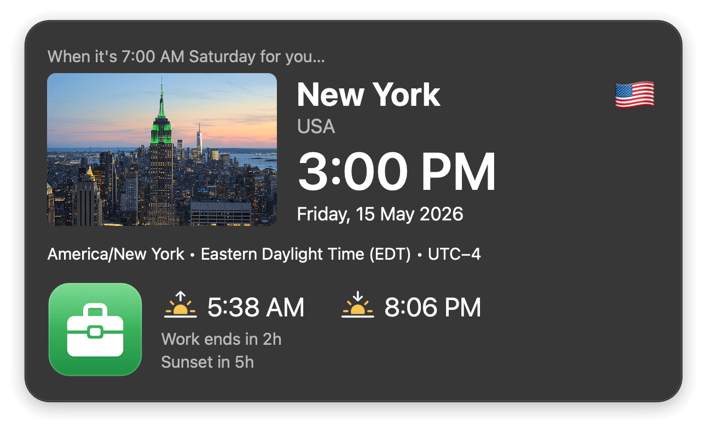

# World Clock Cities

<!-- start of Alfred readme -->

## Usage

View the current time around the world with the `wcc` keyword, or set a Hotkey for it. Type in a specific time or offset (e.g. "+6") to plan for meetings.

Cities come from your Mac's built-in **Clock** app — anything you add to its World Clock list automatically appears in the workflow. Requires **macOS 13** or later — Clock app is not available on earlier versions.

**Clock mode** shows each city's time _now_, with its offset from you and its sunrise and sunset:

Type a city or country to narrow the list: `wcc new` matches both **New York, USA** and **Auckland, New Zealand**.

Your "Home" (🏠️) city is determined by the first city in the Clock app that matches your current time zone.

- <kbd>↩</kbd> Show a detail view for the city
- <kbd>⌘</kbd><kbd>↩</kbd> Open the city's detail window, which stays open
- <kbd>⌥</kbd><kbd>↩</kbd> Edit your cities list in the Clock app
- <kbd>⌃</kbd> _(held)_ Show the city's full time zone info, e.g. "Pacific/Auckland • New Zealand Daylight Time (NZDT) • UTC+13"

From the detail view, <kbd>↩</kbd> or <kbd>⌘</kbd><kbd>↩</kbd> open its detail window; <kbd>⎋</kbd> closes it, and <kbd>⌫</kbd> returns to Alfred's results.

## Meeting mode

Enter a time after the `wcc` keyword to switch to **meeting mode** and see who's asleep, who's in the office, or when they're likely to get there — handy for finding a meeting time that suits everyone.

- `wcc 3pm` or `wcc 15:00`: the next 3pm in your time zone
- `wcc 9am mon`: the next Monday 9am
- `wcc 9am London`: 9am in London (assuming London is in your Clock list)
- `wcc +5`, `wcc +90m` or `wcc -3`: five hours from now, 90 minutes from now, three hours ago
- `wcc +`: meeting mode for right now

As in clock mode, hold <kbd>⌃</kbd> to show the city's full time zone info for the entered time.

The detail view also reflects the entered time:

To switch modes _without_ changing the time, add a `-` to the end of the query: e.g. `wcc 3pm London -` shows clock mode at 3pm in London.

**Note**: Daylight saving changes are reflected in the projected times, and the workflow tells you about a clock change coming up in the next week, or before the entered time. Weekends follow each country's conventions (e.g. Friday-Saturday in Israel), but public holidays are not currently taken into account.

## Offline first

All the time zone math is fully offline — location, time zone, weekend and daylight savings data come from your Mac, and the workflow uses this to calculate the solar information. The only thing that requires a network connection is the city thumbnails in the detail view, and these do a one-time lookup to Wikipedia the first time the workflow is invoked, then cache the results for future reference.

## Configuration

The following preferences can be tailored to your needs in the workflow's configuration panel:

- **Keyword** and **Hotkey**
- **Time format**: follow your Mac's setting, or always 12- or 24-hour time
- **Home city**: Show or hide your own city (🏠️) in the results (while still seeing it in the Clock app)
- **Sort by time zone**: Clock's order, or by UTC offset
- **Working day start time** and **end time**: the times determining each city's "at work" status
- **City pictures**: download city image thumbnails from Wikipedia for the detail views
- **Custom pictures**: your own choice of picture for any city, one per line as `City: URL`. The URL can be a Wikimedia Commons file page (e.g. `San Francisco: https://commons.wikimedia.org/wiki/File:GoldenGateBridge-001.jpg`) or just its file name (`San Francisco: File:GoldenGateBridge-001.jpg`), any image URL, or a `file://` URL for a photo of your own (with three slashes, e.g. `Home: file:///Users/me/Pictures/home.jpg`). Lines starting with `#` are ignored. If a picture can't be loaded, the city gets its default one.
- **Action keys**: which modifier key does each action
- **Window buttons**, **Corner radius** and **Transparency**: the look of the detail window

## Permissions

Alfred should have asked for these permissions when you first set it up, but the workflow requires:

- **Full Disk Access** to read Clock's list of cities (macOS 15 and later)
- **Accessibility access** and **Automation access to System Events** to open the Clock app to its World Clock tab

If missing, grant them in System Settings > Privacy & Security.

## Credits

Workflow created with the assistance of [Claude Code](https://claude.com/product/claude-code).

City pictures come from Wikipedia and Wikimedia Commons, and remain their photographers' work under their own licences. Pictures in the screenshots above, cropped:

- Auckland: [Auckland skyline](https://commons.wikimedia.org/wiki/File:Auckland_skyline_-_May_2024_(2).jpg) by elpinto007, [CC BY-SA 2.0](https://creativecommons.org/licenses/by-sa/2.0/)
- New York: [View of Empire State Building from Rockefeller Center](https://commons.wikimedia.org/wiki/File:View_of_Empire_State_Building_from_Rockefeller_Center_New_York_City_dllu_(cropped).jpg) by Dllu, [CC BY-SA 4.0](https://creativecommons.org/licenses/by-sa/4.0/)

<!-- end of Alfred readme -->

---

For more detail on how the workflow works, see the [developer notes](DEVELOPMENT.md).
